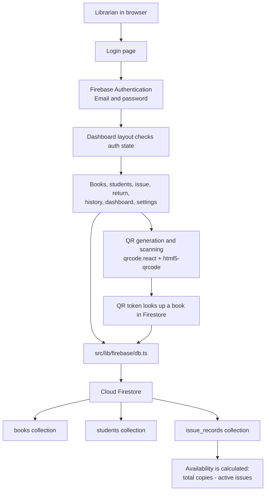

# 📚 QR Library Management System

A QR-based School Library Management Web Application built with **Next.js (App Router)**, **TypeScript**, **Tailwind CSS**, **Firebase Authentication**, and **Cloud Firestore**.

Designed specifically for school libraries to eliminate manual register paperwork and streamline book inventory, issuance, and returns.

---

## 🌟 Core Business Logic: Shared QR Code Architecture

### 🔑 Single QR Code Per Book Title (Not Per Physical Copy)
In a school library setting with 10–50 copies of textbooks (e.g. *NCERT Class XI Physics*), generating individual unique QR codes for each physical copy creates operational chaos: copies get misplaced, damaged, or swapped.

**This application uses a centralized Shared QR Code system:**
- **1 Registered Book Record** = **1 Unique Book ID** = **1 Stable QR Token** = **1 Printable QR Code**.
- **Every physical copy** of that book title shares the **exact same QR code sticker**.
- Increasing total inventory (e.g. adding 5 more copies) **never requires regenerating or reprinting QR codes**.

### 📊 Real-Time Dynamic Inventory Formula
Availability is **never stored as a static, independently editable number** to prevent inventory drift.
$$\text{Available Copies} = \text{Total Copies} - \text{Active Unreturned Issue Records}$$
$$\text{Issued Copies} = \text{Count of Active Issue Records}$$

### 🔄 Intelligent Return Selection Workflow
Because the QR code identifies the **book title**, scanning a returned book displays all students who currently hold an unreturned copy of that title. The librarian selects the student handing in the copy and confirms the return in one click.

### 🔒 Inventory Tracking
Book availability is calculated from active, unreturned Firestore issue records rather than stored as a separate editable count.

---

## 🛠️ Technology Stack

| Layer | Technology |
|---|---|
| **Framework** | Next.js 16 (App Router) with React 19 |
| **Language** | TypeScript (strict mode) |
| **Styling** | Tailwind CSS v4 with custom SaaS design tokens |
| **Database** | Firebase Cloud Firestore |
| **Authentication** | Firebase Authentication (email/password) |
| **QR Generation** | `qrcode.react` (SVG rendering with high error correction) |
| **QR Scanning** | `html5-qrcode` (webcam camera + manual token fallback) |
| **Forms & Validation**| React Hook Form + Zod schema validation |
| **Icons** | Lucide React |

---

## 🚀 Getting Started

### 1. Prerequisites
- Node.js 18+ installed on your system.
- A [Firebase](https://firebase.google.com/) project with Authentication and Cloud Firestore enabled.

### 2. Install Dependencies
```bash
npm install
```

### 3. Configure Firebase
1. In Firebase Console, create a project and register a Web app.
2. Enable **Authentication > Sign-in method > Email/Password**.
3. Create a **Cloud Firestore** database.
4. Configure Firestore Security Rules to allow only authenticated librarian accounts to access library records. Client-side route checks are not a substitute for database rules.

### 4. Configure Environment Variables
Create a `.env.local` file in the project root:
```env
NEXT_PUBLIC_FIREBASE_API_KEY=your-api-key
NEXT_PUBLIC_FIREBASE_AUTH_DOMAIN=your-project.firebaseapp.com
NEXT_PUBLIC_FIREBASE_PROJECT_ID=your-project-id
NEXT_PUBLIC_FIREBASE_STORAGE_BUCKET=your-project.firebasestorage.app
NEXT_PUBLIC_FIREBASE_MESSAGING_SENDER_ID=your-sender-id
NEXT_PUBLIC_FIREBASE_APP_ID=your-app-id
```
Find these values in Firebase Console under **Project settings > Your apps**.

### 5. Create a Librarian Account and Run
Create an account from the app's sign-up option, then start the application:
```bash
npm run dev
```
Open [http://localhost:3000](http://localhost:3000) in your web browser.

---

## 📖 Librarian User Guide

### 1. Registering Books & Printing QR Stickers
1. Navigate to **Books > Add New Book**.
2. Fill in the Title, Author, Subject/Category, Class/Grade, and Total Physical Copies.
3. Click **Register Book & Generate QR**.
4. The system automatically creates a unique token and displays the QR code badge.
5. Click **Download PNG** or **Print Label**.
6. Affix the printed QR sticker to the inside cover of every physical copy of that title.

### 2. Issuing a Book
**Method A: Via Camera Scan**
- Click **Scan QR** in the sidebar.
- Point the webcam at the book's QR code.
- Click **Issue Book** on the detected book card.

**Method B: Via Issue Form**
- Navigate to **Issue Book** in the sidebar.
- Search for the book title or author.
- Search for the student by name or admission number.
- The return due date defaults to 14 days from today (customizable).
- Click **Confirm & Issue Book**. The inventory updates instantly.

### 3. Returning a Book
1. Navigate to **Return Book** or scan the book's QR code.
2. The system lists all students currently holding an active loan of that title.
3. Select the student returning the copy.
4. Click **Confirm Return**.
5. The book's available count increases by 1, and the return timestamp is recorded permanently.

### 4. Student Management & Overdue Tracking
- Navigate to **Students** to view total borrowed books and active loans per student.
- Click **View Profile** on any student to see unreturned books and complete historical records.
- Overdue loans are clearly flagged in red badges across the Dashboard, Student Profiles, and Issue History.

### 5. Issue History & Audit Trail
- View complete historical logs with status filters (`Active`, `Overdue`, `Returned`).
- Filter by date range (Today, Last 7 Days, Last 30 Days).
- Click **Export CSV** to download a spreadsheet report for school administration.

---

## 📁 Project Structure

```
├── src/
│   ├── app/
│   │   ├── (dashboard)/            # Authenticated application shell
│   │   │   ├── dashboard/          # Real-time statistics & quick actions
│   │   │   ├── books/              # Books list, detail, add, edit & QR printing
│   │   │   ├── scan/               # QR scanner (camera + manual input)
│   │   │   ├── issue/              # Book issuing
│   │   │   ├── return/             # Borrower selection & inventory restoration
│   │   │   ├── students/           # Student directory & borrowing profiles
│   │   │   ├── history/            # Audit logs, status filters & CSV export
│   │   │   ├── settings/           # Library preferences & account info
│   │   │   └── layout.tsx          # Responsive layout with dark navy sidebar
│   │   ├── login/                  # Librarian authentication screen
│   │   ├── globals.css             # Tailwind v4 theme tokens & animations
│   │   └── layout.tsx              # Root HTML wrapper
│   ├── components/
│   │   ├── layout/sidebar.tsx      # Sidebar navigation & mobile drawer
│   │   └── ui/toast.tsx            # Toast notification context provider
│   ├── lib/
│   │   ├── firebase/               # Firebase client and Firestore data access
│   │   ├── utils/                  # Date formatting, overdue check, classnames
│   │   └── validations/            # Zod schemas for all forms
│   ├── types/                      # TypeScript definitions & status enum
│   └── middleware.ts               # Root route redirect
└── README.md
```

## 🔁 Application Flow: What Each Service Is Used For



| What you use | What it does in this app |
|---|---|
| **Firebase Authentication** | Signs librarians in with email/password and keeps the browser session. |
| **Cloud Firestore** | Stores books, students, and issue/return history in the `books`, `students`, and `issue_records` collections. |
| **`src/lib/firebase/client.ts`** | Initializes the Firebase app, Authentication, and Firestore clients from the `NEXT_PUBLIC_FIREBASE_*` settings. |
| **`src/lib/firebase/db.ts`** | Reads and writes Firestore records; calculates current availability and dashboard/history data. |
| **`qrcode.react`** | Creates the shared QR code for each book record. |
| **`html5-qrcode`** | Scans a book QR code with the browser camera; manual token entry is the fallback. |
| **Next.js / React** | Renders the app pages and checks the Firebase Auth state before showing dashboard content. |
| **React Hook Form + Zod** | Handles form state and validates form input. |

When a book is scanned, its QR token is looked up against `books`; issuing creates an `issue_records` entry, and returning fills in that record's `return_date`. Available copies are derived from the total copies minus active issue records, rather than stored separately.

**Security setup:** The browser connects directly to Firebase. Configure and deploy Firestore Security Rules in Firebase Console so only authorized signed-in librarians can read or change library records. The dashboard's client-side auth check alone does not protect Firestore data.

---

## 🛡️ Security & Privacy Architecture

- **Authentication**: Firebase Authentication manages librarian sign-in.
- **Firestore Rules**: Configure Firebase Security Rules to protect all database reads and writes. Frontend route checks alone do not secure Firestore data.
- **Zero Student PII in QR Codes**: QR codes only encode an opaque random token (`/scan/[TOKEN]`), preventing student personal data leaks if a book leaves the premises.
- **Firebase Configuration**: The Firebase web app configuration is public client configuration; enforce access through Firebase Security Rules.

---

## 🚢 Production Deployment (Vercel)

1. Push your repository to GitHub.
2. In [Vercel](https://vercel.com), import the repository.
3. In **Settings > Environment Variables**, add:
   - `NEXT_PUBLIC_FIREBASE_API_KEY`
   - `NEXT_PUBLIC_FIREBASE_AUTH_DOMAIN`
   - `NEXT_PUBLIC_FIREBASE_PROJECT_ID`
   - `NEXT_PUBLIC_FIREBASE_STORAGE_BUCKET`
   - `NEXT_PUBLIC_FIREBASE_MESSAGING_SENDER_ID`
   - `NEXT_PUBLIC_FIREBASE_APP_ID`
4. Click **Deploy**. Vercel will automatically build the Next.js production bundle.
